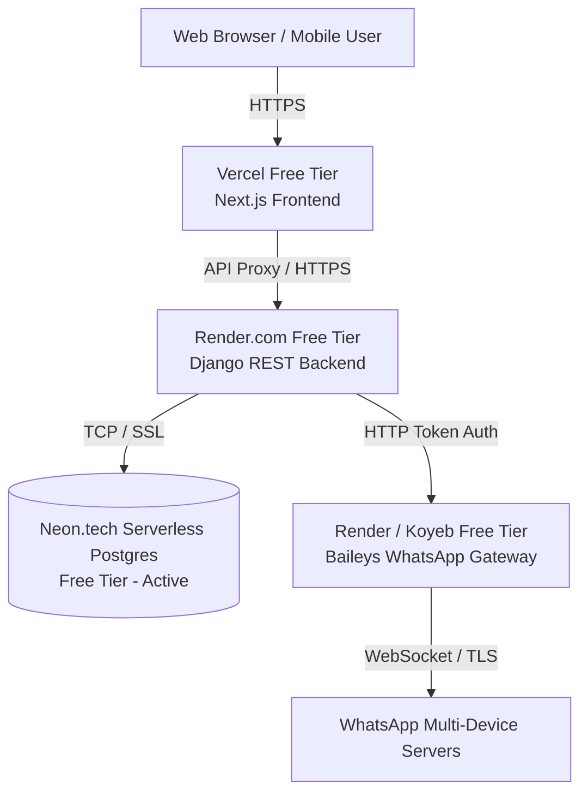

# 🚀 100% Free Hosting Guide for WhatsBridge

This guide explains how to host the complete **WhatsBridge** platform (Frontend, Backend, WhatsApp Multi-Device Gateway, and Neon PostgreSQL Database) completely **free of cost**.

---

## 🏗️ Free Hosting Architecture



| Component | Technology | Free Hosting Provider | Monthly Cost |
| :--- | :--- | :--- | :---: |
| **Database** | PostgreSQL 17 | **Neon.tech** (Already live!) | **$0 / month** |
| **Frontend** | Next.js 16 (React 19) | **Vercel** | **$0 / month** |
| **Backend** | Django 5 + Uvicorn | **Render.com** | **$0 / month** |
| **WhatsApp Gateway** | Baileys + Express Node.js | **Render.com** or **Koyeb** | **$0 / month** |

---

## ⚡ Method 1: Vercel + Render + Neon (Recommended)

### Step 1: Database (Already Done on Neon)
Your Neon PostgreSQL database is already configured and verified:
- **Neon Branch:** `production`
- **Connection URL:** Configured in your `.env` as `DATABASE_URL`

---

### Step 2: Deploy Backend & WhatsApp Gateway to Render.com

1. Push your repository to **GitHub** (public or private):
   ```bash
   git init
   git add .
   git commit -m "Initial commit for deployment"
   git remote add origin https://github.com/<your-username>/whatsbridge.git
   git push -u origin main
   ```

2. Go to [dashboard.render.com](https://dashboard.render.com) (sign up with GitHub).
3. Click **New +** > **Blueprint**.
4. Connect your `whatsbridge` GitHub repository.
5. Render will detect [`render.yaml`](file:///Users/shiyasahmad/Documents/whatsbridge/render.yaml) automatically:
   - It will create **`whatsbridge-backend`** (Python Web Service).
   - It will create **`whatsbridge-gateway`** (Node.js Web Service).
6. Fill in the required environment variables in the Render dashboard:
   - `DATABASE_URL`: Paste your Neon PostgreSQL connection string:
     ```text
     postgresql://<user>:<password>@<ep-pooler-host>.neon.tech/neondb?sslmode=require
     ```
   - `GEMINI_API_KEY`: Your Google Gemini API Key from `.env`
7. Click **Apply**. Render will automatically build, migrate, and launch both services with free SSL HTTPS URLs (e.g. `https://whatsbridge-backend.onrender.com`).

---

### Step 3: Deploy Frontend to Vercel

1. Go to [vercel.com](https://vercel.com) and log in with your GitHub account.
2. Click **Add New...** > **Project**.
3. Import your `whatsbridge` repository.
4. Configure Project settings:
   - **Root Directory:** Click edit and select `frontend`
   - **Framework Preset:** Next.js
5. Under **Environment Variables**, add:
   - `BACKEND_URL`: Your Render backend URL (e.g., `https://whatsbridge-backend.onrender.com`)
6. Click **Deploy**.
7. In ~60 seconds, your site is live with a free `.vercel.app` domain and free SSL!

---

## ⏰ Step 4: Keep Render & Neon Database Awake (No Sleep 10-Minute Check)

Render free tier web services spin down after 15 minutes of inactivity. Neon serverless Postgres also pauses when idle.

To keep Render and Neon PostgreSQL **awake 24/7 with ZERO sleep**, a periodic check call to `/health` is used:
- The `/health` endpoint executes `SELECT 1` on the Neon PostgreSQL database.
- It counts as inbound HTTP traffic for Render, resetting Render's 15-minute inactivity timer.
- Both your backend and your database stay hot and ready 24/7 without cold starts!

### Choose Any of These 100% Free Methods:

#### Option A: UptimeRobot (Easiest & Most Popular)
1. Sign up for free at [uptimerobot.com](https://uptimerobot.com).
2. Click **Add New Monitor**:
   - **Monitor Type:** `HTTP(s)`
   - **Friendly Name:** `WhatsBridge Backend & Neon DB`
   - **URL:** `https://whatsbridge-backend.onrender.com/health`
   - **Monitoring Interval:** `5 minutes` or `10 minutes`
3. Click **Create Monitor**.
4. *(Optional)* Add a second monitor for the gateway: `https://whatsbridge-gateway.onrender.com/health`.
UptimeRobot will ping your server every 5–10 minutes, keeping both Render and Neon PostgreSQL awake permanently.

#### Option B: GitHub Actions (Already Included in This Repository!)
We added [`.github/workflows/keep_alive.yml`](file:///Users/shiyasahmad/Documents/whatsbridge/.github/workflows/keep_alive.yml).
1. In your GitHub repository, go to **Settings > Secrets and variables > Actions**.
2. Add secret `RENDER_BACKEND_URL`: `https://whatsbridge-backend.onrender.com`
3. GitHub Actions will automatically fire every 10 minutes, pinging `/health`, executing `SELECT 1` on Neon, and keeping Render awake!

#### Option C: Cron-job.org
1. Sign up for free at [cron-job.org](https://cron-job.org).
2. Create a cron job:
   - **URL:** `https://whatsbridge-backend.onrender.com/health`
   - **Schedule:** Every 10 minutes (`*/10 * * * *`)
   - **Method:** `GET`
3. Save.

## 🌟 Method 2: Oracle Cloud Always Free VM (All-in-One 24/7 Server)

If you want the entire Docker Compose setup running on a single dedicated cloud machine with zero cold starts and 24/7 uptime for free forever:

1. Sign up for **Oracle Cloud Free Tier** ([cloud.oracle.com](https://cloud.oracle.com)).
2. Create an **Ampere A1 Compute Instance** (Always Free):
   - **Specs:** 4 ARM OCPUs, 24 GB RAM, 200 GB Storage (100% Free Forever)
   - **OS:** Ubuntu 24.04 LTS
3. SSH into the instance:
   ```bash
   ssh ubuntu@<YOUR_INSTANCE_IP>
   ```
4. Install Docker and Docker Compose:
   ```bash
   sudo apt update && sudo apt install -y docker.io docker-compose-plugin
   ```
5. Clone your repository:
   ```bash
   git clone https://github.com/<your-username>/whatsbridge.git
   cd whatsbridge
   ```
6. Copy `.env` and start all services:
   ```bash
   docker compose -f compose.yaml -f compose.production.yaml up -d
   ```
7. Point your domain (or free DuckDNS / Cloudflare) to your Oracle VM IP. All services, WhatsApp socket, and dashboard will run 24/7 for $0.
